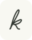

<p align="center"></p>

# keykomi

My personal website at [keykomi.com](https://keykomi.com). A short CV in English and Russian, with an interactive ASCII postcard beside it.

The collection has 220 places. Each image comes from a real photograph converted into letters, numbers and symbols. Hover reveals its original colours; clicks send independent waves across it. Phones show just the text.

Built with Astro, TypeScript and WebGL. The result is static files served by Caddy.

## Run locally

Use Node 26.9 or newer and pnpm 12.4.2.

```sh
pnpm install --frozen-lockfile
pnpm dev
```

```sh
pnpm verify
pnpm build
```

The build is in `apps/web/dist`. Existing PDF resumes are included; `pnpm resume` builds previews with Typst and Poppler; `pnpm resume:publish` explicitly updates the website copies. [CV template](resume/README.md).

Copy is in `content/minimal.json`. Resume facts are in `content/resume/resume.yaml`. Image sources and licences are recorded in `content/atlas/source-lock.json` and available from each postcard's caption.

[Deployment](deploy/README.md) explains releases, CI setup and rollback. [Atlas tools](content/atlas/README.md) explains the image pipeline. [На русском](README.ru.md).
